# Skyward

English | [简体中文](README.zh-CN.md)

Skyward is a recovery written in Rust, from scratch.

<p align="center">
  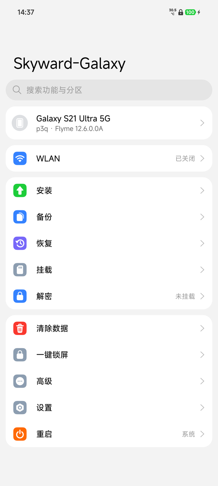
  
  
</p>

## Features

### Dual boot

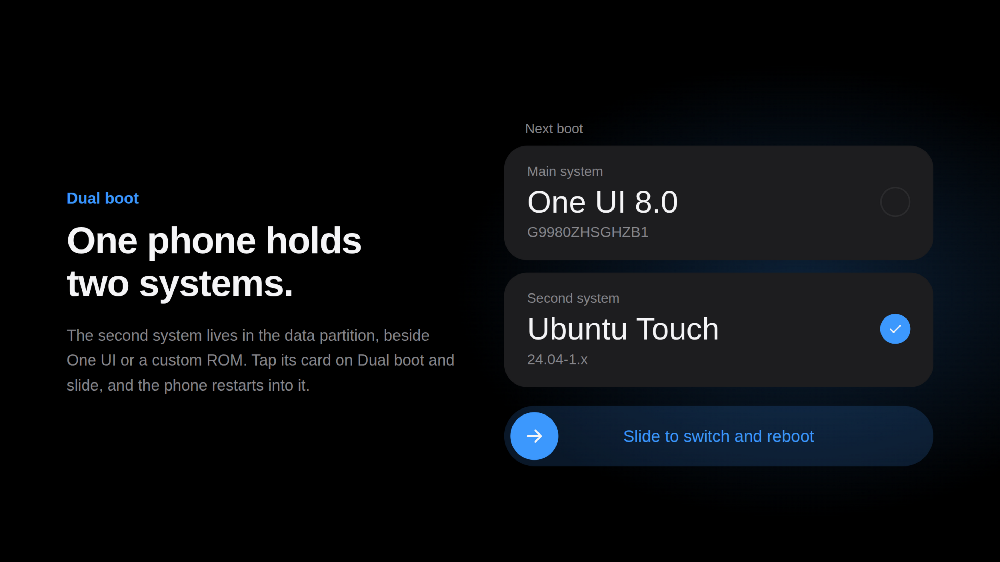

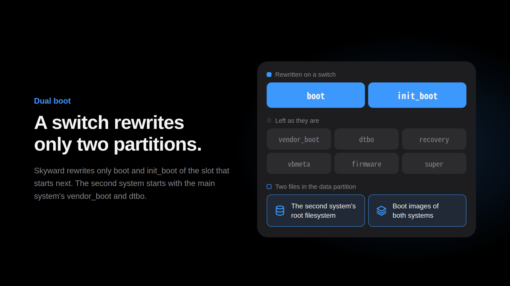

How a second system is packaged and started is in
[How dual boot works](#how-dual-boot-works).

### Decryption

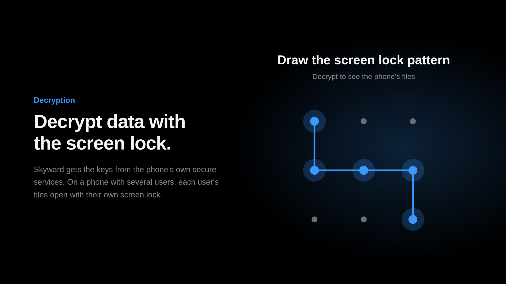

### Installing

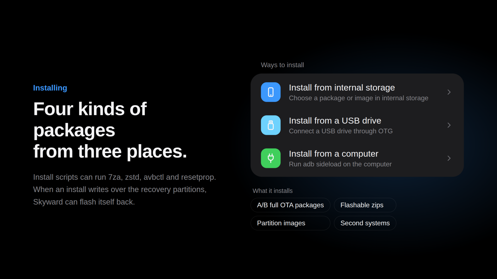

Install scripts get `7za` and `zstd`, which ROMs with a super image compressed by
zstd use to flash it, and an `unzip` whose `-p` streams the image as it reads it.
They also get `avbctl` and `resetprop`, to turn off verified boot's checks and to
read and set properties.

### Online updates

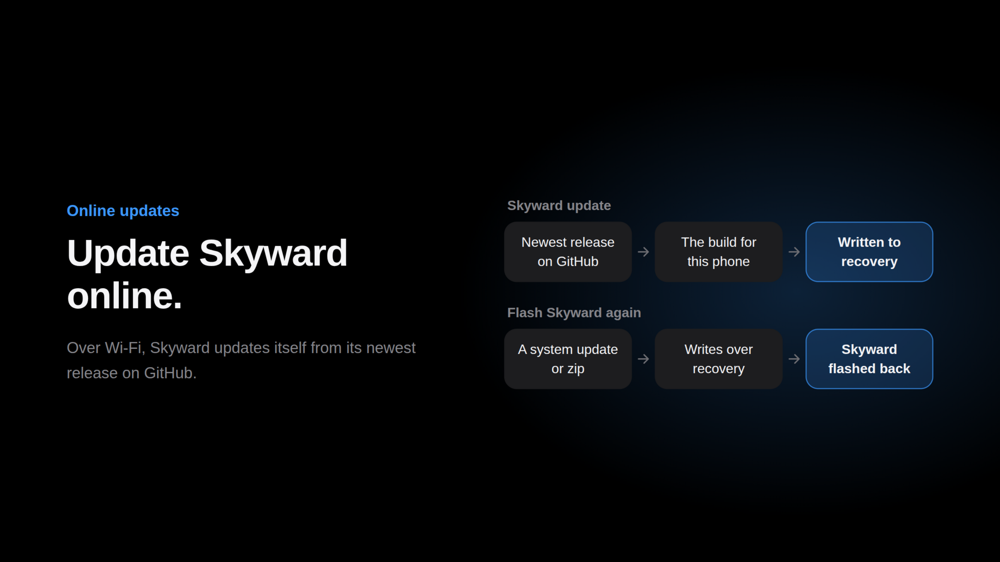

Skyward updates itself over Wi-Fi from its newest release on GitHub, writing the
build for the phone into the recovery partitions. System packages still install
from the Install page.

### Backup and restore

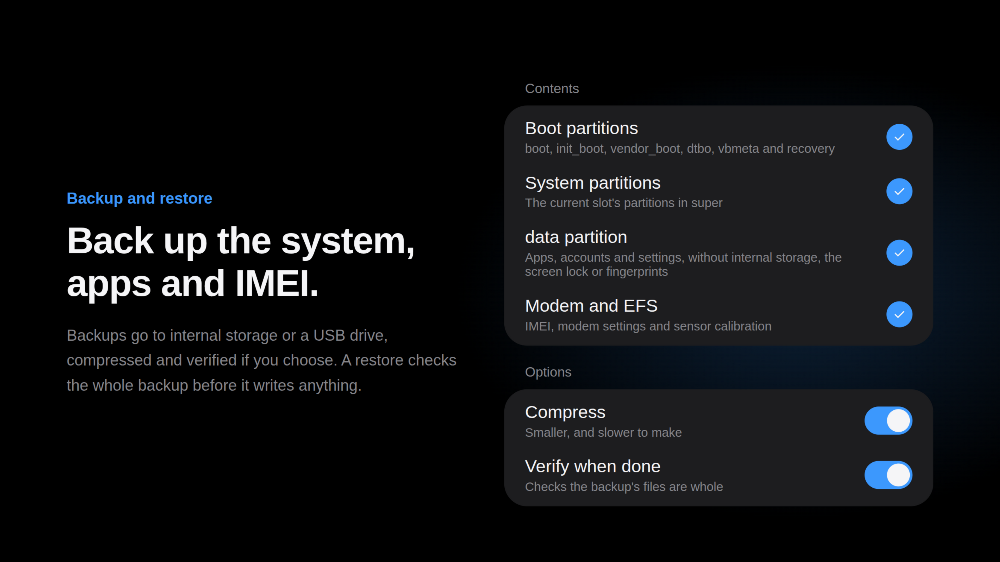

### File manager

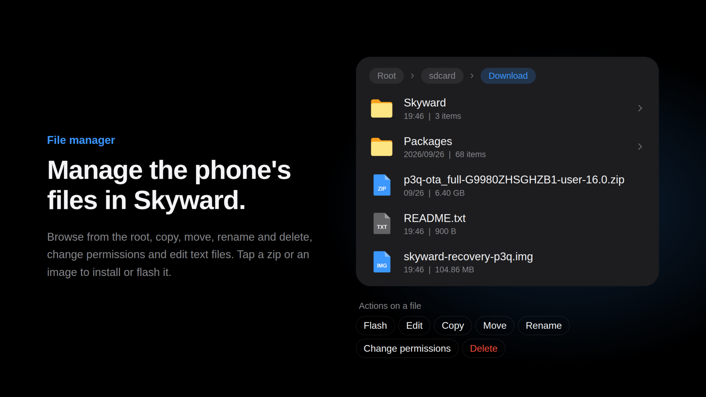

### Terminal

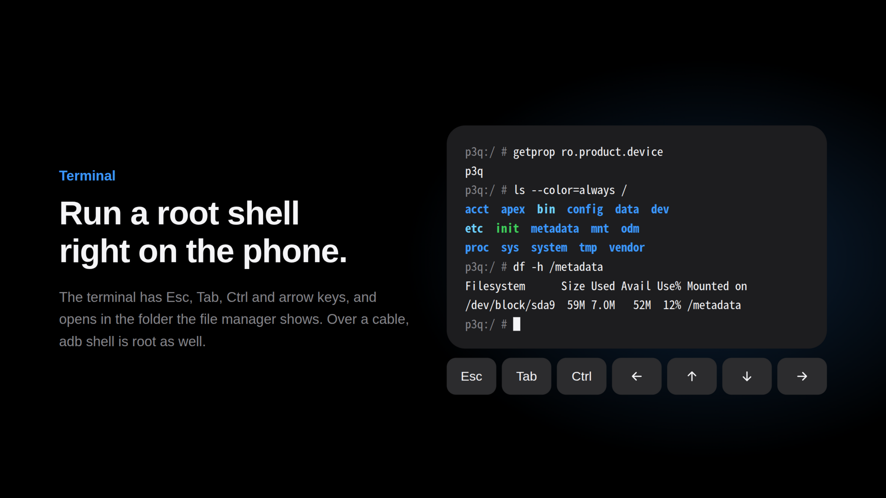

### Connecting a computer

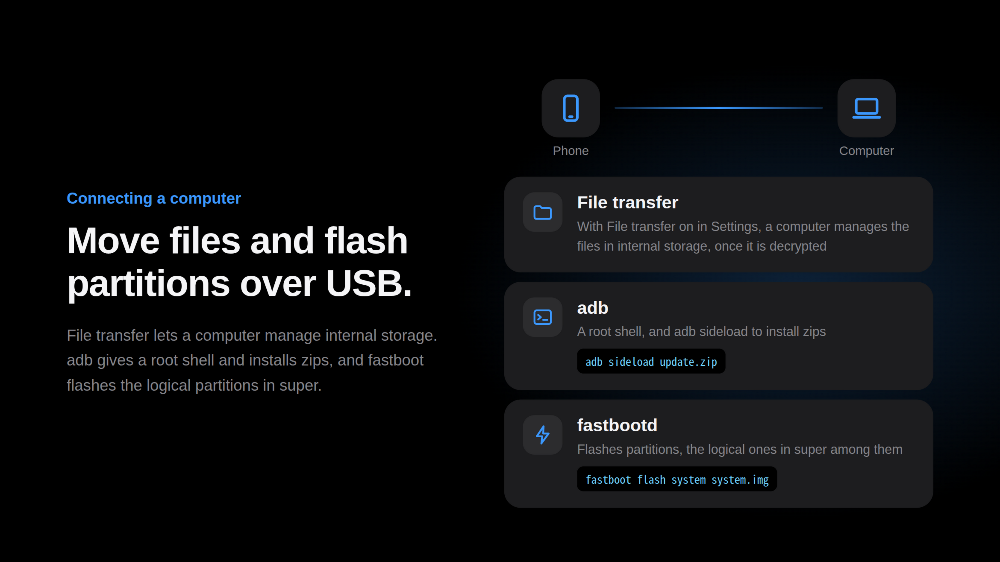

### Wiping data

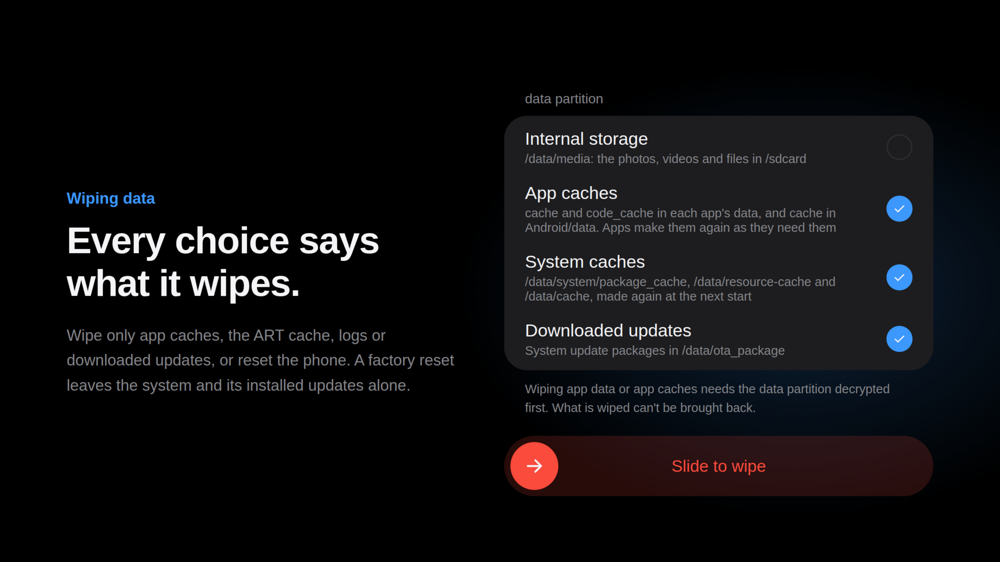

### Replacing the stock recovery

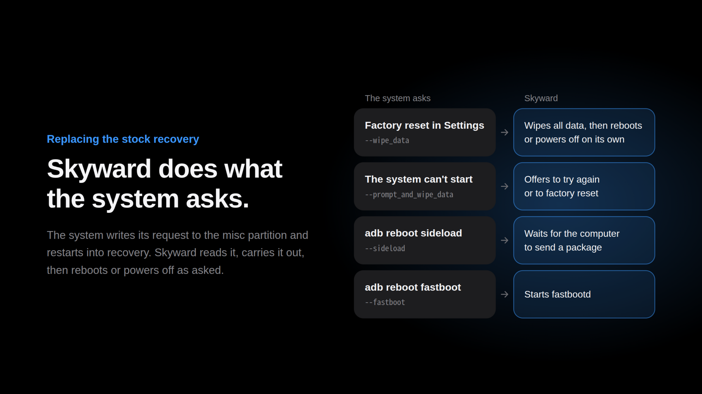

### Search

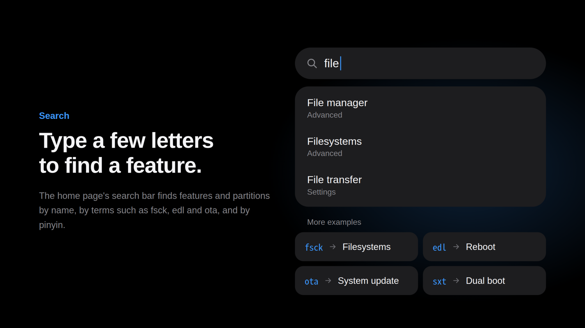

### Advanced

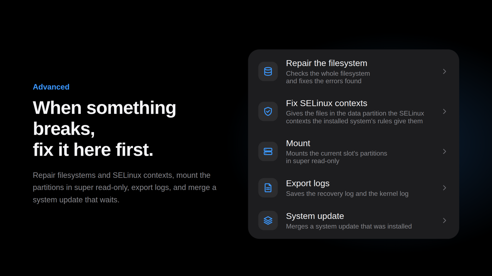

### About phone

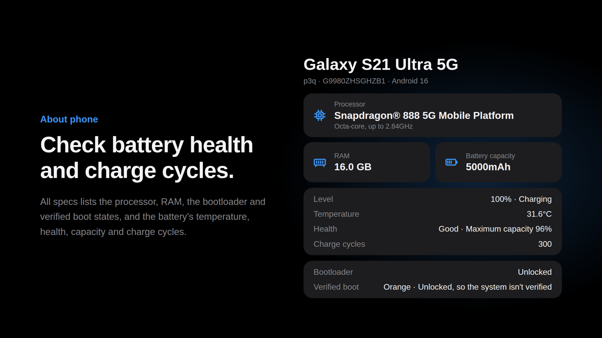

### Other features

- Reboot to system, recovery, fastboot, bootloader or EDL, and switch slots
- Light and dark themes; Simplified Chinese, Traditional Chinese and English

### Without a system

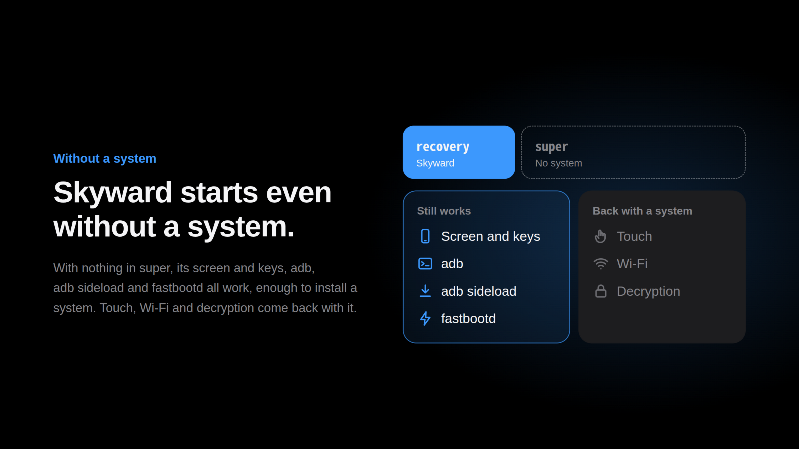

## Supported devices

| Device | Codename | Built on |
| --- | --- | --- |
| Galaxy S21 Ultra 5G | `p3q` | OrangeFox recovery for the phone's stock Android 11 vendor |
| Galaxy S20+ 5G | `y2q` | OrangeFox recovery for the phone's stock vendor |

Both are A-only Samsung phones: no partition carries a slot suffix, and the
recovery is built on an OrangeFox recovery image, because a Samsung stock recovery
does not start on them. The base images are published as the `base-images`
release of this repository, each named `<codename>-fox-recovery.img`. The S21
Ultra's image also takes the kernel module, firmware and vendor interface
libraries its recovery kernel leaves out, laid out as they go into the ramdisk in
`p3q-files.zip` in the same release; the S20+'s needs none.

## Installing Skyward

Skyward needs an unlocked bootloader. Download the zip for your phone from
[Releases](https://github.com/yanzihan/Skyward-Galaxy/releases), where each shows
as the phone's model and codename, such as Galaxy S21 Ultra 5G (p3q). Check it
against `SHA256SUMS`, unzip it, and flash the image inside to the recovery
partition, with the phone in fastboot mode:

```sh
unzip skyward-v0.3.1-p3q-base.zip
fastboot flash recovery skyward-v0.3.1-p3q-base.img
fastboot reboot recovery
```

The second system's first program runs before any library is there to load, so it
is built as a static program:

```sh
RUSTFLAGS="-C target-feature=+crt-static" cargo ndk -t arm64-v8a --platform 30 build --release -p skyward-system-init --target-dir target/system-init
```

A Samsung phone is built on its OrangeFox recovery image, which is the whole
recovery partition and ends in an AVB footer (the `base-images` release of this
repository holds one per phone):

```sh
target/release/skyward-pack recovery \
  --stock p3q-fox-recovery.img \
  --binary target/aarch64-linux-android/release/skyward \
  --system-init target/system-init/aarch64-linux-android/release/system-init \
  --config devices/p3q.toml \
  --font resources/fonts/MiSansVF.ttf \
  --mono resources/fonts/KirkMono-Regular.ttf \
  --mono-license resources/fonts/KirkMono-OFL.txt \
  --third-party --no-mtp \
  --out target/skyward-p3q.img
```

A device whose configuration names a `[stock]` build instead has its recovery
partition taken out of that build's full update package, over HTTPS, and checked
against the SHA-256 the configuration gives:

```sh
target/release/skyward-pack stock --config devices/<codename>.toml --out stock/recovery.img
```

The tests whose names start with `on_the_phone` make filesystems, mount them and
set encryption keys, which only a phone does. With a phone in Skyward attached over
adb, its data partition open, `cargo ndk` pushes each test program to the phone and
runs it there, one test at a time:

```sh
cargo ndk -t arm64-v8a --platform 30 test -p skyward -p skyward-block -p skyward-files -p skyward-mtp on_the_phone -- --test-threads=1
```

`skyward-preview` draws the pages on the computer, as PNG files, without a phone:
each page whole, as a long screenshot shows it, in the states it can be in, and the
screen at moments of touches and motion. `--lang` picks the language by a locale
such as `en` or `zh-TW`:

```sh
cargo run --release -p skyward-preview -- target/preview --lang en
```

## License

[GPL-3.0-or-later](LICENSE)
