# Skyward

[English](README.md) | 简体中文

Skyward 是使用 Rust 编写的 recovery，从零开始编写。

<p align="center">
  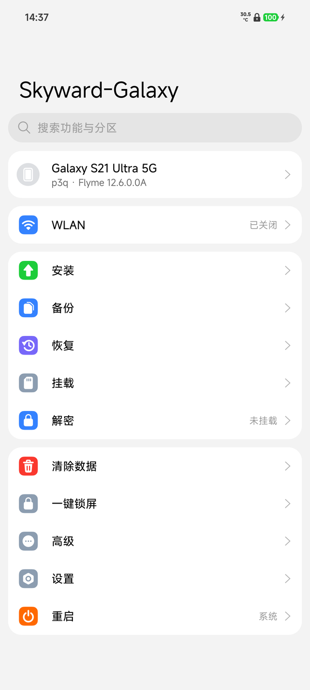
  
  
</p>

## 功能

### 双系统

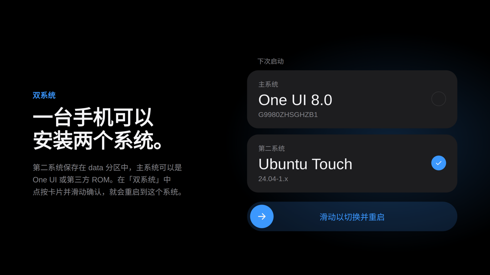

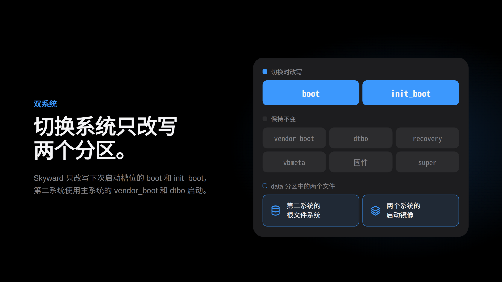

第二系统的安装包格式和启动过程见下文的[双系统的工作方式](#双系统的工作方式)。

### 解密

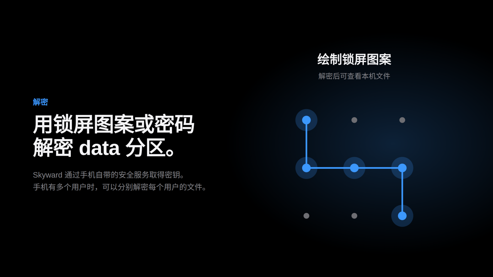

### 安装

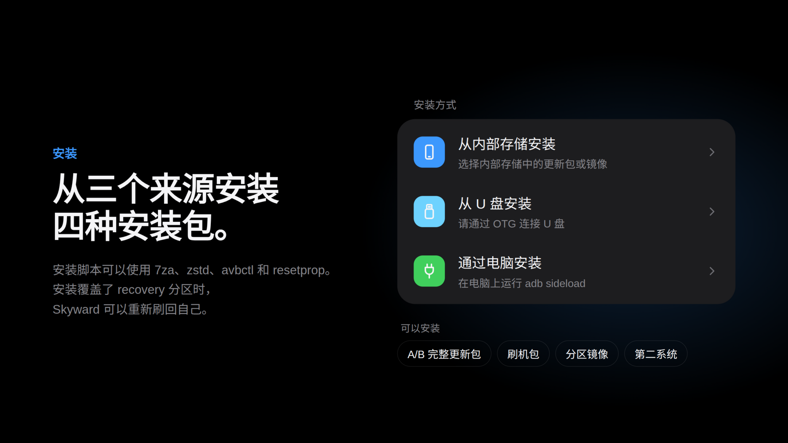

刷机包的安装脚本可以使用 `7za` 和 `zstd`，支持刷入 super 镜像使用 zstd 压缩的第三方 ROM；`unzip -p` 边解压边输出镜像。安装脚本还可以使用 `avbctl` 关闭验证启动的校验，使用 `resetprop` 读取和设置属性。

### 在线更新

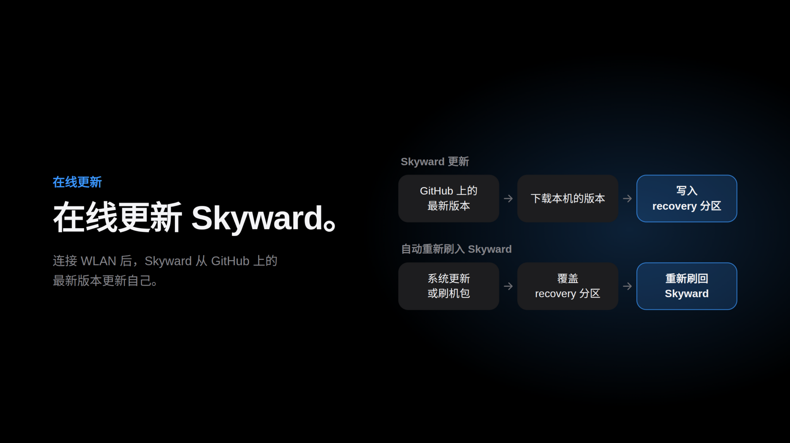

连接 WLAN 后，Skyward 从 GitHub 上的最新版本更新自己，把本机的版本写入 recovery 分区；系统刷机包仍然从“安装”页面安装。

### 备份和恢复

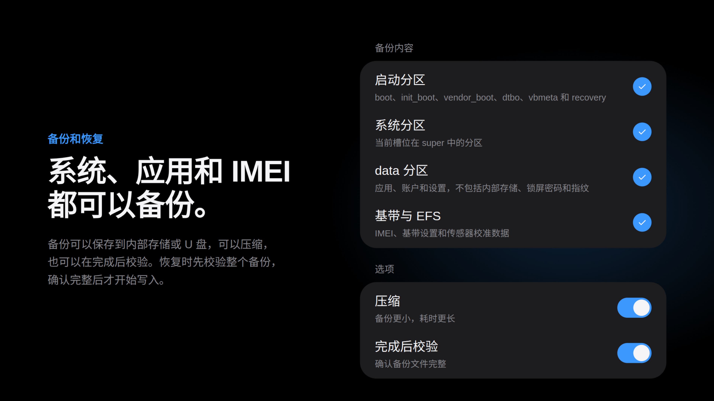

### 文件管理

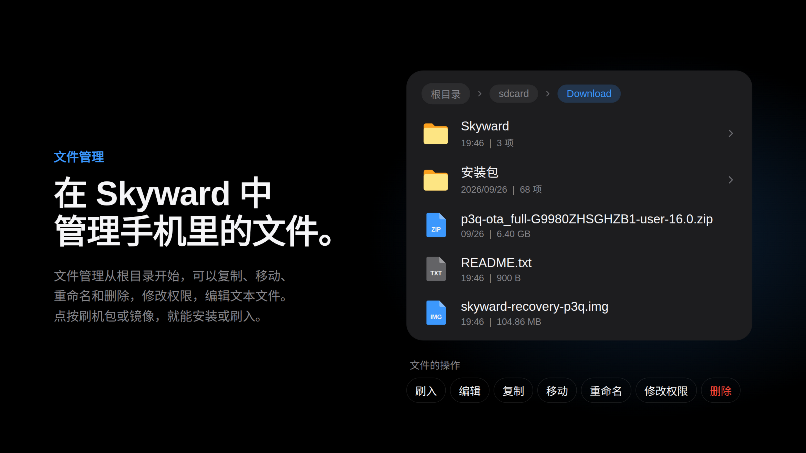

### 终端

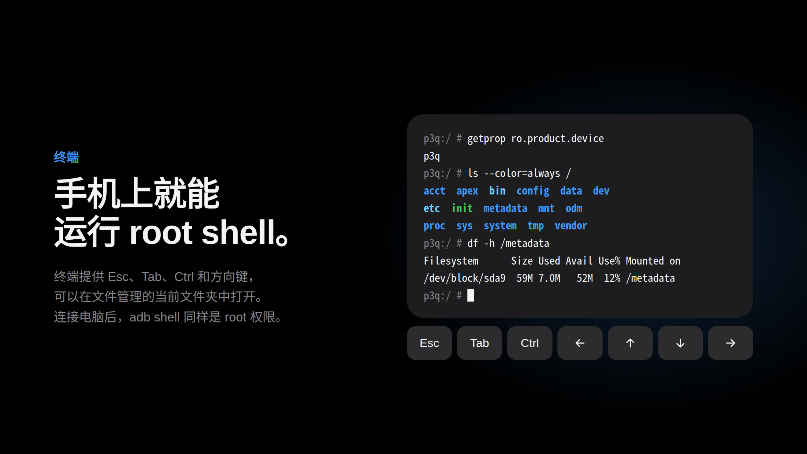

### 连接电脑

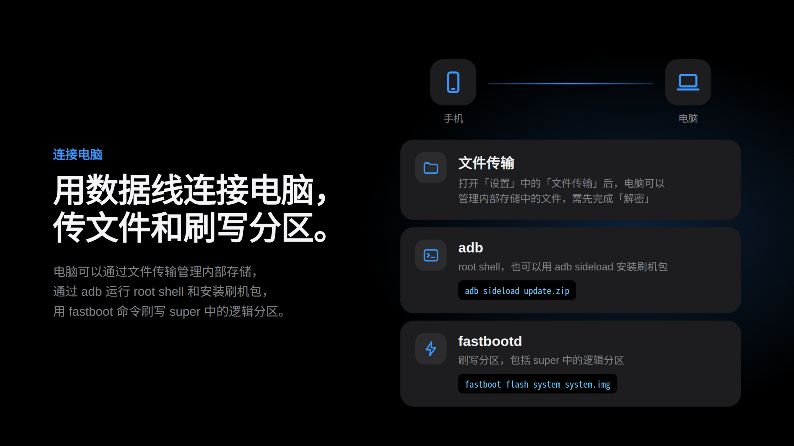

### 清除数据

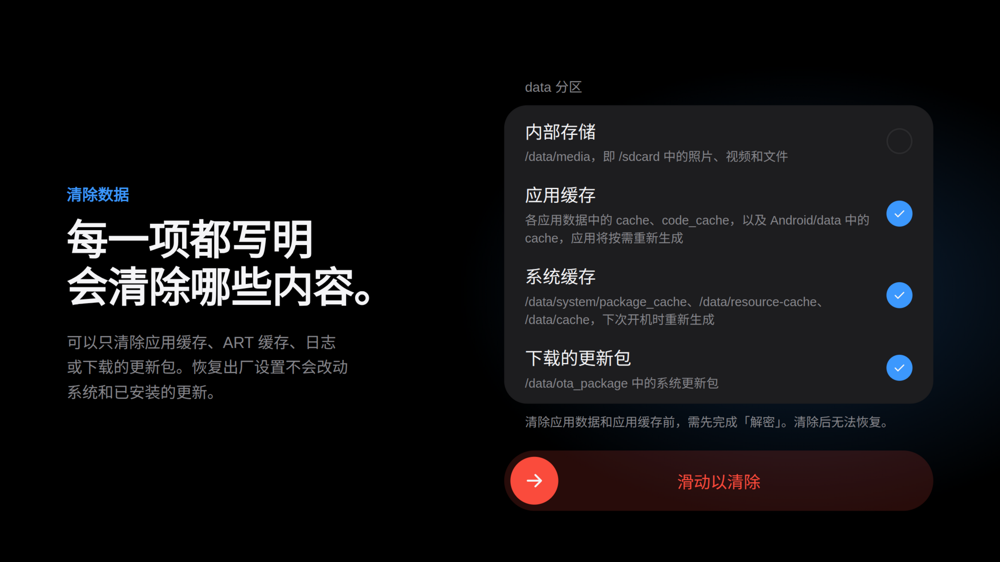

### 替换原厂 recovery

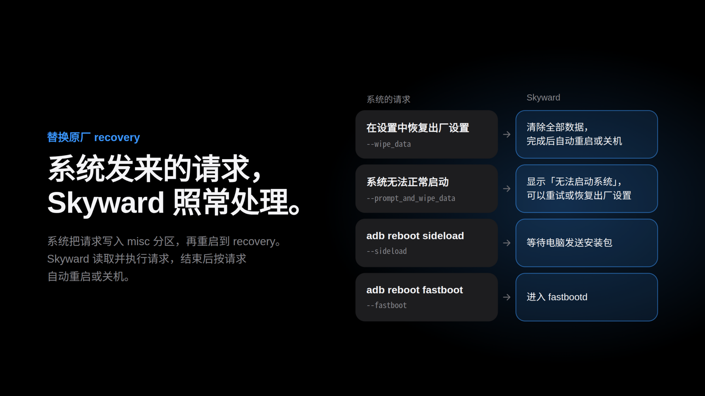

### 搜索

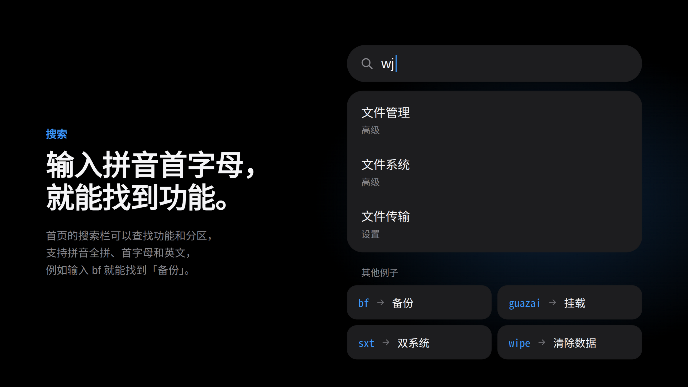

### 高级

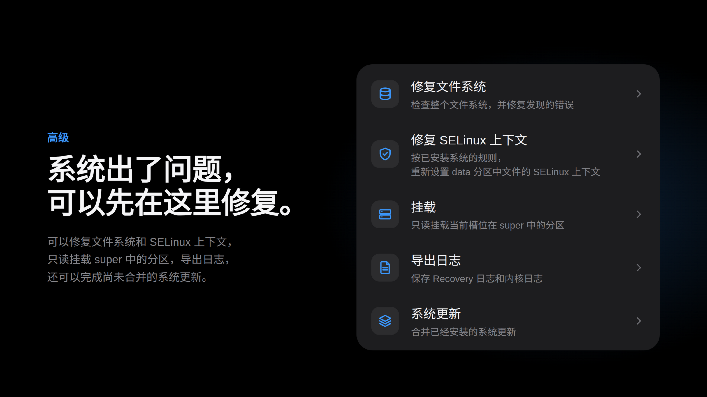

### 关于本机

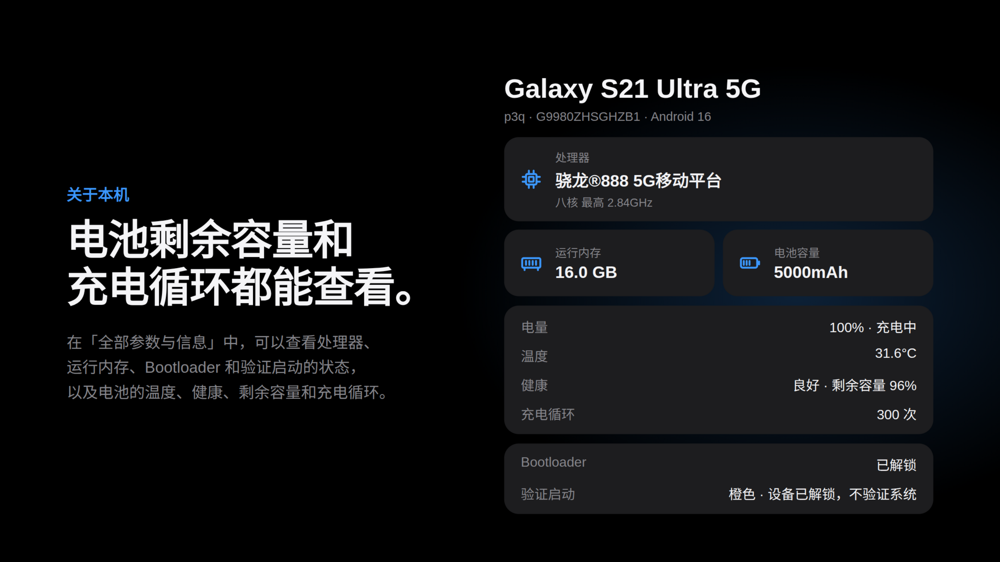

### 其他功能

- 重启到系统、recovery、fastboot、bootloader 和 EDL，切换启动槽位
- 浅色和深色模式，简体中文、繁体中文和英文

### 没有系统时

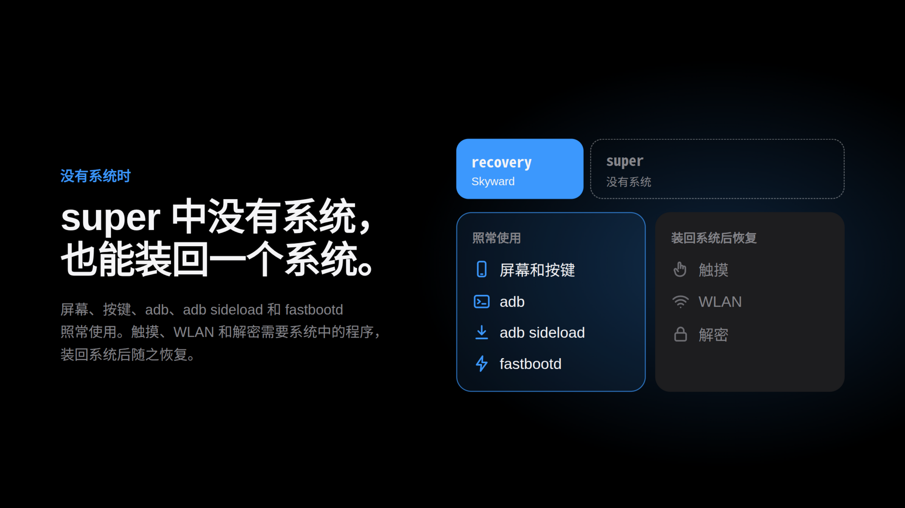

## 支持的机型

| 机型 | 代号 | 构建所用的基底 |
| --- | --- | --- |
| Galaxy S21 Ultra 5G | `p3q` | 原厂 Android 11 vendor 上的 OrangeFox recovery |
| Galaxy S20+ 5G | `y2q` | 原厂 Android 11 vendor 上的 OrangeFox recovery |

两台都是 A-only 三星手机：分区不带 `_a/_b` 后缀，recovery 构建在 OrangeFox 的 recovery 镜像上，因为三星原厂 recovery 在这两台机器上起不来。基底镜像发布在本仓库的 `base-images` release，文件名分别是 `<代号>-fox-recovery.img`。S21 Ultra 的镜像还需要它的 recovery 内核没有内建的模块、固件和 vendor 接口库，这些放在同一个 release 的 `p3q-files.zip` 里，目录结构就是它们在 ramdisk 里的位置；S20+ 不需要。

## 安装 Skyward

Skyward 需要已解锁的 bootloader。从 [Releases](https://github.com/yanzihan/Skyward-Galaxy/releases) 下载对应机型的 zip，每个文件都标有机型和代号，例如 Galaxy S21 Ultra 5G (p3q)。使用 `SHA256SUMS` 核对并解压之后，在手机处于 fastboot 模式的时候，把其中的镜像刷入 recovery 分区：

```sh
unzip skyward-v0.3.1-p3q-base.zip
fastboot flash recovery skyward-v0.3.1-p3q-base.img
fastboot reboot recovery
```

第二系统启动时运行的第一个程序在任何动态库可用之前运行，因此构建为静态程序：

```sh
RUSTFLAGS="-C target-feature=+crt-static" cargo ndk -t arm64-v8a --platform 30 build --release -p skyward-system-init --target-dir target/system-init
```

三星机型构建在它自己的 OrangeFox recovery 镜像上，这份镜像是整个 recovery 分区，末尾带 AVB footer（本仓库的 `base-images` release 每台各有一份）：

```sh
target/release/skyward-pack recovery \
  --stock p3q-fox-recovery.img \
  --binary target/aarch64-linux-android/release/skyward \
  --system-init target/system-init/aarch64-linux-android/release/system-init \
  --config devices/p3q.toml \
  --font resources/fonts/MiSansVF.ttf \
  --mono resources/fonts/KirkMono-Regular.ttf \
  --mono-license resources/fonts/KirkMono-OFL.txt \
  --third-party --no-mtp \
  --out target/skyward-p3q.img
```

配置里写了 `[stock]` 的机型，则改为从该版本的完整更新包中通过 HTTPS 取出 recovery 分区，并按配置给出的 SHA-256 核对：

```sh
target/release/skyward-pack stock --config devices/<代号>.toml --out stock/recovery.img
```

名称以 `on_the_phone` 开头的测试会创建文件系统、挂载分区、设置加密密钥，这些操作只有手机能够完成。把一台已经进入 Skyward、数据分区已经打开的手机通过 adb 连接到电脑，`cargo ndk` 会把每个测试程序推送到手机上运行，测试逐个执行：

```sh
cargo ndk -t arm64-v8a --platform 30 test -p skyward -p skyward-block -p skyward-files -p skyward-mtp on_the_phone -- --test-threads=1
```

`skyward-preview` 无需手机，在电脑上把页面绘制成 PNG 文件：每个页面完整绘制成长截图的样子，覆盖它可能处于的各种状态，另外还有触摸和动画过程中某些时刻的屏幕。`--lang` 按照地区代码选择语言，例如 `en` 或者 `zh-TW`：

```sh
cargo run --release -p skyward-preview -- target/preview --lang en
```

## 许可证

[GPL-3.0-or-later](LICENSE)
